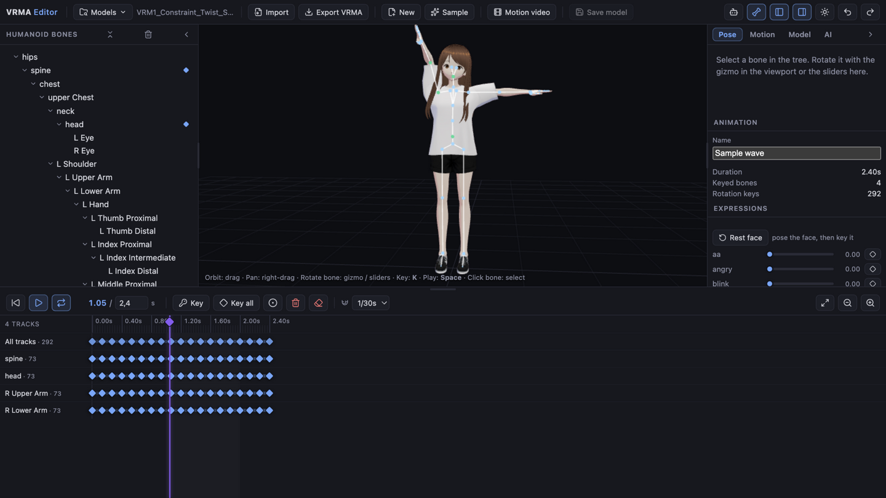
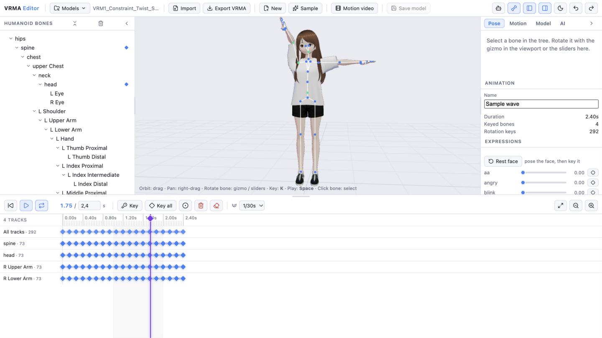
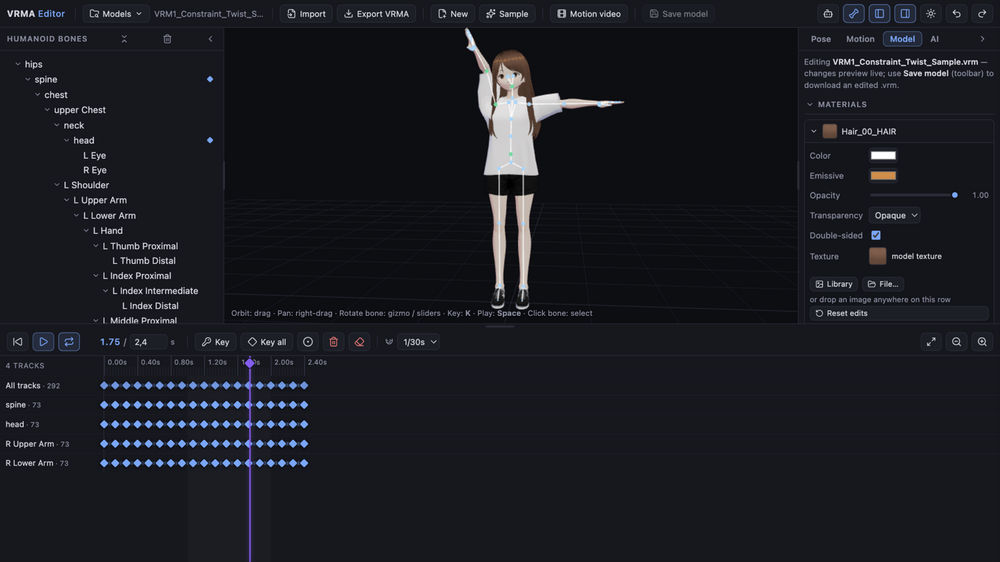

<div align="center">

# VRMA Editor

**A browser-based studio for VRM models and animations** — pose the rig, set keyframes, track motion from a webcam or video, edit the model itself, and export spec-compliant `.vrma` / `.vrm` files. All locally, nothing uploaded.

    



</div>

## Highlights

- 🦴 **Keyframe animation** — pose the humanoid rig with a rotate gizmo, key poses (<kbd>K</kbd>), scrub and loop on the timeline, retime keys, add easing
- 🧍 **Motion tracker** — drive the model live from your webcam, or track a video file into keyframe animation (in-browser MediaPipe, nothing uploaded)
- 🎨 **Model editing** — materials, texture replacement, outfit presets, expressions, meta and body proportions — then save as a new `.vrm`
- 🤖 **AI assistant** — drives the editor through tools from natural language, including motion extraction from a video of a person ([docs/AI.md](docs/AI.md))
- 📦 **Spec-compliant `.vrma`** — imports and exports [VRMC_vrm_animation 1.0](https://github.com/vrm-c/vrm-specification/blob/master/specification/VRMC_vrm_animation-1.0/README.md) (binary glTF), validated with the Khronos glTF validator
- 🌗 **Light & dark themes** — the whole UI, the timeline and even the 3D viewport follow your choice, remembered across reloads
- 🗂️ **Model library** — drop models into `assets/models/` and they appear in the toolbar dropdown; your last session (model, layout, theme) is remembered

| Dark | Light |
| --- | --- |
|  |  |

## Quick start

```bash
npm install
npm run dev      # http://localhost:5173
```

`vite.config.ts` serves `assets/` as the public dir; a dev middleware lists `assets/models/` for the library dropdown (static builds fall back to `assets/models/manifest.json`).

## Layout

- **Resize the footer** by dragging its top edge (double-click the edge to reset)
- **Resize the side panels** by dragging their inner edges (double-click to reset)
- **Hide/show the side panels** with the `◧`/`◨` toggles in the toolbar or the chevrons in each panel header
- The layout (panel visibility + footer height) is remembered in your browser

## Model library

Drop `.vrm` / `.glb` / `.gltf` files into **`assets/models/`** — they appear in the **Models ▾** dropdown (no restart needed in dev). *Open file…* loads any file from disk without adding it to the library. The last-used model is remembered in localStorage.

## Texture library

Drop `.png` / `.jpg` / `.webp` images into **`assets/textures/`** — they appear in the texture picker (Library button in each material's Texture row, shown as a thumbnail grid). The 31 textures shipped there were extracted from `demo.glb`; delete or replace them freely. Replace an image, pick from the library, or drag & drop any image file onto a material row — the new texture previews live and is **embedded into the exported .vrm** on save.

## Model editing (Model tab)



The right panel has **Pose**, **Motion**, **Model** and **AI** tabs. The Model tab edits the loaded model with instant live preview:

| Section | What you can do |
| --- | --- |
| **Materials** | Base color, emissive, opacity, transparency mode (opaque / cutout / blend), double-sided, **texture replacement** (library picker, file dialog, or drag & drop an image onto the material row), per-material reset |
| **Assets** | Switch clothes, hair and other baked-in asset pieces: every primitive of a merged mesh (VRoid-style models bake each clothing/hair piece as its own part) gets an eye toggle, grouped into Top / Bottom / Feet / Underwear / Hair / Face / Body / Accessory. Save the current visibility as a named **outfit preset** and switch outfits with one click — the last-used outfit is re-applied when you reload the model |
| **Expressions** | Slider per expression (happy, blink, custom…). Weights are **baked into the model** on save |
| **Meta** | Title/author/license etc. (schema-aware: VRM 0.x vs 1.0 fields) |
| **Proportions** | Body part scaling (×0.5–×1.5). Torso/limb sliders thicken **in place** — child joints keep their size and position (no stretched neighbours); head, hands, feet and hips scale the whole part |

**Save model** (toolbar) downloads the edited model as `<name>-edited.vrm`. Edits are applied to the *original file's glTF JSON* and the GLB is repacked — everything not edited (spring bones, MToon shaders, constraints, first-person) passes through untouched, so the output validates with 0 errors. Hidden asset parts are **removed** from the glTF (their primitive is deleted), so the exported model has no trace of the hidden piece; hiding every primitive of a merged mesh clears the mesh node entirely.

Details worth knowing:

- Works with VRM 0.x and 1.0; expression names are shown in VRM 1.0 naming and mapped back to 0.x presets (`joy`/`sorrow`/…) on export
- Saved expression weights are written into the file's rest pose (default morph weights); on reload the editor detects them and previews the baked face
- Proportions export as glTF `node.scale` on the humanoid bones, with the same child compensation as the preview — the saved file matches what you saw. A few VRM apps may still normalize humanoid bone scale on import
- Edits reset when you switch models; they apply to the live preview only until you save

## Motion tracker (Motion tab)

The right panel's **Motion** tab has two modes over the same in-browser pose-tracking pipeline (MediaPipe — nothing uploaded; the WASM runtime and pose model are fetched from their CDNs on first use and cached afterwards):

**Live (realtime)** — click **Start live**: your webcam tracks you frame by frame and the loaded model **moves in real time** (the timeline pauses; the tracked pose is a preview override). Adjust **Smoothing** live. With **Capture keyframes** on (default), stopping retargets the take into a keyframe clip and imports it as the current animation — like any import, one undo step — and playback starts. With capture off it's a pure mirror: stopping just returns the model to the timeline pose.

**From a video** — **Load video** (mp4/webm/mov), pick a **segment** (start/end), **sample rate** (10–30 fps) and **smoothing** (moving-average window, 0 = raw), then **Track motion**. Segments longer than 60 s are processed in consecutive chunks automatically.

Both retarget the tracked skeleton onto the humanoid rig (FK per bone: hips, spine, chest, head, arms, legs) and show a result summary with frame coverage and sparse tracks (usually occluded body parts). Clean the result up on the timeline — delete noisy tracks, add easing — then **Export VRMA**.

Monocular limits: no finger/hand data, hips translation is recovered in the screen plane only (vertical bob + lateral sway — forward/back travel is not recoverable).

## Workflow

1. **Select a bone** in the left tree (or click a bone name) — a rotate gizmo appears on it in the viewport.
2. **Pose it** with the gizmo or the X/Y/Z sliders in the Pose tab. For hips you also get position-offset sliders.
3. **Key it**: press <kbd>K</kbd> (or *Key*) to record the selected bone's current pose at the playhead, or *Key all* to record the whole pose. Enable the **auto-key** toggle (◎ in the transport bar) to record automatically while you manipulate bones.
4. **Scrub** the timeline, pose again, key again — playback interpolates between keyframes (quaternion slerp, linear time).
5. **Export VRMA** downloads your animation as `.vrma`.

### Shortcuts

| Key | Action |
| --- | --- |
| `Space` | Play / pause |
| `K` | Key selected bone (hips: rotation + position) |
| `Del` / `Backspace` | Delete selected keyframe |
| `Ctrl/Cmd+Z` / `Ctrl/Cmd+Shift+Z` | Undo / redo (animation and model edits) |
| `Home` | Playhead to start |

Timeline: drag the ruler to scrub, drag diamonds to retime keys, right-click a diamond to delete it. Snap options: off, 1/60, 1/30, 1/24, 1/15, 0.1s, 0.5s, 1s.

### Transitions (velocity / easing)

Click a keyframe diamond on the timeline to select it — the **Transition** section appears in the right panel:

- **Linear** — constant speed (VRMA default)
- **Ease in / out / in-out** — velocity ramps for natural acceleration/deceleration
- **Step** — hold the pose until the next key (sharp pop)

The transition applies to the motion *leaving* the selected key toward the next one, for both rotations and hips position. "Apply to track" sets the same curve on every key of that track. Timeline diamonds are tinted purple for eased keys and orange for steps.

The VRMA spec only allows LINEAR interpolation, so on export every non-linear segment is baked into linear samples at 30 keys/sec (endpoints preserved) — the eased motion survives in any VRMA-compliant application, and the file still validates cleanly.

## VRMA support details

Exports follow the [VRMC_vrm_animation 1.0 spec](https://github.com/vrm-c/vrm-specification/blob/master/specification/VRMC_vrm_animation-1.0/README.md):

- Humanoid bone rotations as LINEAR quaternion channels — compatible with VRM 0.x and 1.0 models
- Hips translation as the absolute normalized-space position of the hips node (VRMA convention), with the rig's rest hips height written on the hips node so consumers can rescale motion onto models of a different height
- FLOAT accessors, GLB container, `VRMC_vrm_animation` extension with a humanoid bone↔node map

Import supports GLB and JSON containers, LINEAR/STEP/CUBICSPLINE interpolation (step & cubic are converted to linear keys), and warns about unsupported channels (expressions, look-at, props are not edited by this tool).

Playing animations on VRM 0.x models conjugates quaternion x/z components and mirrors/scales hips translation exactly like the reference `@pixiv/three-vrm-animation` implementation — imported files (verified against `VRMA_01.vrma`) match the official loader's output to float precision (max diff ~1e-8).

The timeline renders up to ~3,000 diamonds total; dense imported tracks (e.g. 700-key mocap) show a sampled density view with the real key count in the row label.

Validated with the Khronos glTF validator (0 errors / 0 warnings).

## Project layout

```
src/
  lib/
    humanoid.ts        humanoid bone hierarchy (tree UI + export order)
    animation.ts       pose sampling (slerp/lerp), applying to the normalized rig
    vrma/parse.ts      .vrma (glTF/GLB) → editor animation model
    vrma/build.ts      editor animation model → .vrma GLB
    mocap/pose.ts      motion-reference video → pose frames (MediaPipe WASM)
    mocap/retarget.ts  pose frames → humanoid keyframes (VrmaData)
    mocap/live.ts      realtime tracking: webcam → live rig override (+ take capture)
    mocap/webcam.ts    camera access + webcam recording (getUserMedia + MediaRecorder)
    vrmedit/glb.ts     GLB container parse / repack, image embedding
    vrmedit/live.ts    live model edits (materials, expressions, bone scale)
    vrmedit/proportions.ts  proportion config shared by live preview + export
    vrmedit/parts.ts   asset parts: per-primitive collection, categories, visibility
    vrmedit/exportModel.ts  edits → original file's glTF JSON patch (.vrm export)
  components/
    Viewport.tsx       three.js scene, VRM loading, rotate gizmo, playback loop
    Timeline.tsx       transport bar, ruler, scrubbing, keyframe diamonds
    BoneTree.tsx       humanoid bone tree with key indicators
    Inspector.tsx      right panel tabs: Pose / Motion / Model / AI
    MotionPanel.tsx    motion tracker: video/webcam → tracked animation
    ModelPanel.tsx     model editor: materials, assets/outfits, expressions, meta, proportions
    Toolbar.tsx        model library dropdown, file ops, VRMA export, save model
  store.ts             zustand state: tracks, transport, selection, history, model edits
```
